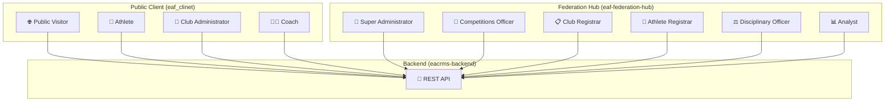
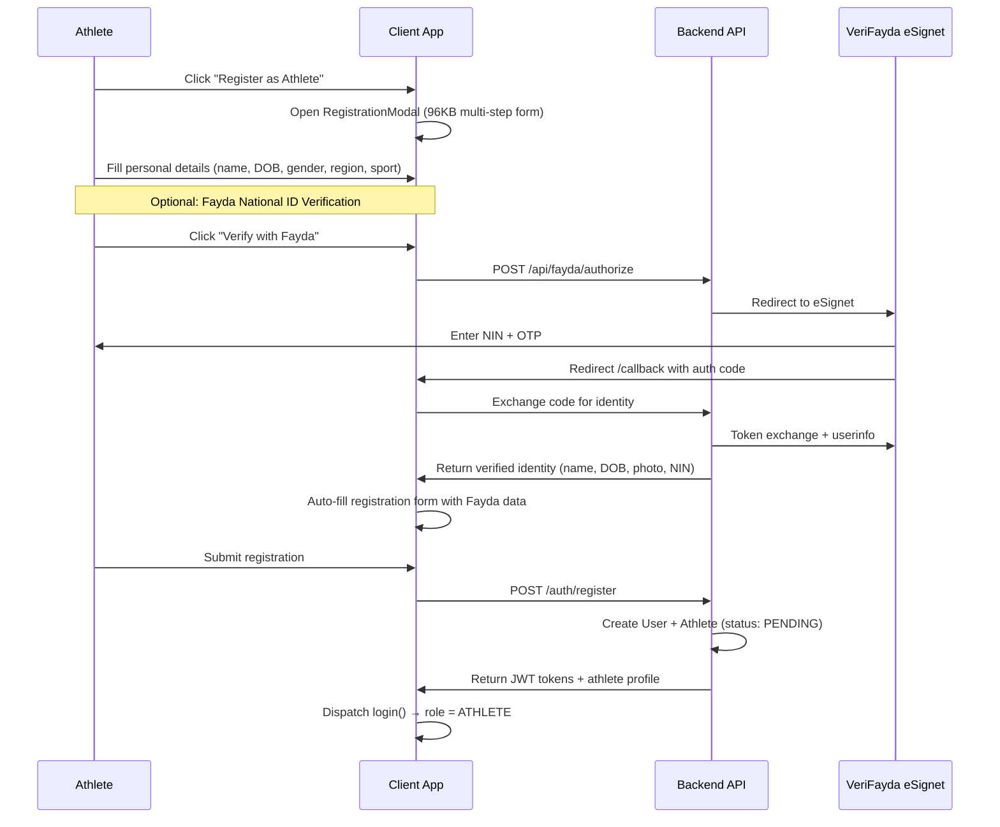
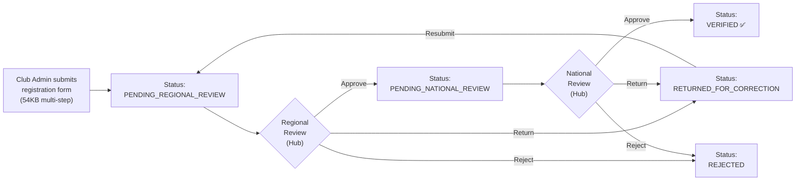
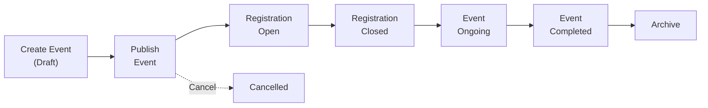
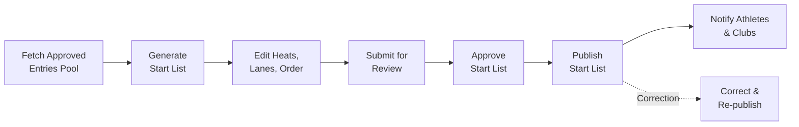
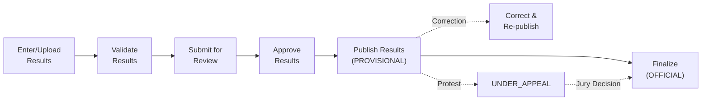
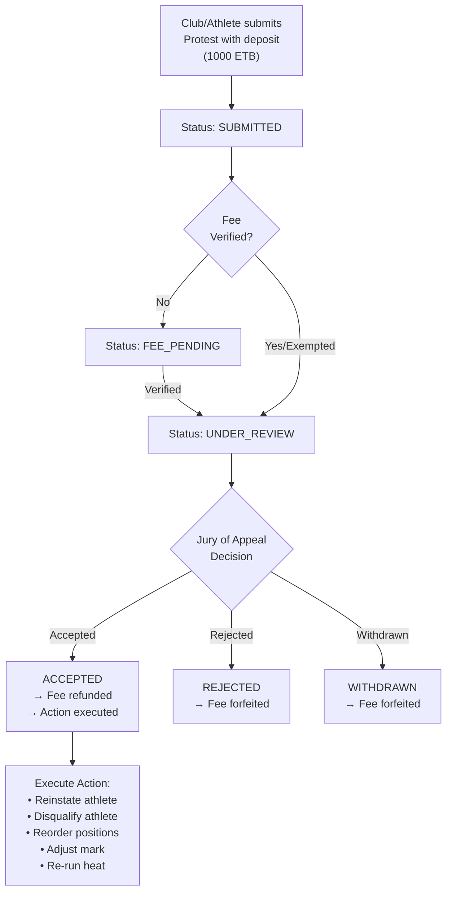
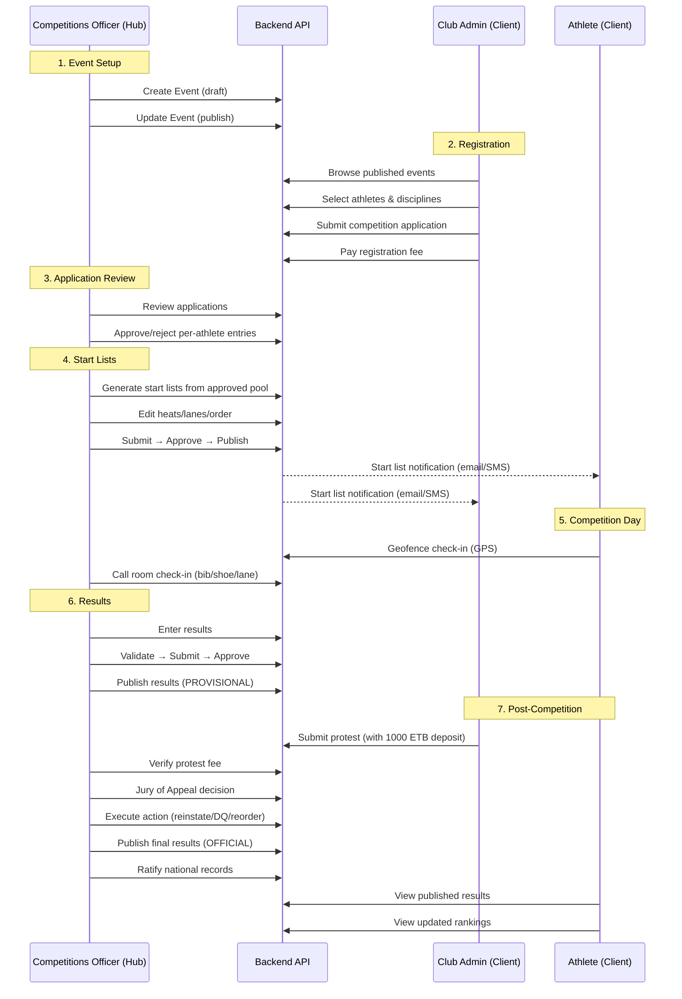

# EAF Platform — User Actor Workflows & User Stories

> [!NOTE]
> This document maps every user actor, their workflows, and user stories across all three systems:
> **eacrms-backend** (API), **eaf-federation-hub** (Admin), **eaf_clinet** (Public Client).

---

## Actor Map

---

## 1. 🌐 Public Visitor (Anonymous)

**System:** `eaf_clinet` (Landing pages)  
**Auth:** None required

### User Stories

| ID | Story | System Flow |
|---|---|---|
| PV-01 | As a visitor, I want to browse the landing page to learn about EAF | Client renders `LandingPage` → `HeroSection` with stats, news, event carousel |
| PV-02 | As a visitor, I want to view upcoming competitions | Client calls `GET /events/published` via RTK Query → Competition cards displayed |
| PV-03 | As a visitor, I want to view a competition's full details | Click on event → `CompetitionDetail` component → Shows schedule, disciplines, venue, results |
| PV-04 | As a visitor, I want to read EAF news articles | Client calls `GET /content/public` → `NewsDetail` component renders article |
| PV-05 | As a visitor, I want to browse the photo gallery | Client calls `GET /gallery` → `GalleryDetail` lightbox viewer |
| PV-06 | As a visitor, I want to view published results | Client calls `GET /results/published` → Results tables with rankings |
| PV-07 | As a visitor, I want to see verified clubs | Client calls `GET /clubs/verified` → Club listing with stats |
| PV-08 | As a visitor, I want to see the athlete registry | Client calls `GET /athletes/public` → Searchable athlete directory |
| PV-09 | As a visitor, I want to contact EAF | `submitContactForm` mutation → `POST /content/contact` |
| PV-10 | As a visitor, I want to verify an athlete's license by scanning a QR code | Public license verification → `GET /licenses/verify/:code` |
| PV-11 | As a visitor, I want to switch the site language | Language selector → Switch between English, Amharic (አማርኛ), Oromo, Tigrinya (ትግርኛ) |
| PV-12 | As a visitor, I want to view regional federation info | `RegionalFederationsHub` component → Shows regions, clubs per region, athlete counts |
| PV-13 | As a visitor, I want to view the professionals registry | `ProfessionalsRegistry` component → Coaches, officials, medical staff |
| PV-14 | As a visitor, I want to toggle dark/light mode | `darkMode` state persisted to `localStorage` |

---

## 2. 🏃 Athlete

**System:** `eaf_clinet` (Athlete portal, role = `ATHLETE`)  
**Auth:** JWT (email/password login) + optional Fayda national ID

### 2.1 Registration & Identity Verification

| ID | Story |
|---|---|
| ATH-01 | As an athlete, I want to register with my personal details |
| ATH-02 | As an athlete, I want to verify my identity using Fayda national ID so my profile is auto-filled and trusted |
| ATH-03 | As an athlete, I want to upload a secondary identity document if I don't have Fayda |
| ATH-04 | As an athlete, I want to log in with email/password to access my dashboard |
| ATH-05 | As an athlete, I want my session to auto-refresh so I don't get logged out unexpectedly |

### 2.2 Dashboard & Profile

| ID | Story | Component |
|---|---|---|
| ATH-06 | As an athlete, I want to see my dashboard with an overview of my status, upcoming events, and notifications | `AthleteOverview` (67KB) |
| ATH-07 | As an athlete, I want to edit my profile (photo, bio, specialties, contact info, medical info) | `AthleteProfile` (59KB) |
| ATH-08 | As an athlete, I want to view my personal bests and season bests | `AthleteOverview` → PB/SB cards |
| ATH-09 | As an athlete, I want to track my training logs (type, distance, duration, notes) | `AthleteOverview` → training log section |
| ATH-10 | As an athlete, I want to log my weight over time | `AthleteOverview` → weight log chart |
| ATH-11 | As an athlete, I want to view my notifications | `AthleteNotifications` |

### 2.3 Events & Competitions

| ID | Story | Component |
|---|---|---|
| ATH-12 | As an athlete, I want to browse competitions I can apply to | `AthleteEvents` |
| ATH-13 | As an athlete, I want to apply for a competition (selecting disciplines) | `AthleteApplications` |
| ATH-14 | As an athlete, I want to check in at a competition venue using geofence | `GeofenceCheckin` (25KB) — GPS-based |
| ATH-15 | As an athlete, I want to view my competition results and rankings | `EventResults` |
| ATH-16 | As an athlete, I want to view live race tracking | `LiveRaceTracker` |

### 2.4 License & Records

| ID | Story | Component |
|---|---|---|
| ATH-17 | As an athlete, I want to view my athlete license with QR code | `LicenseQrCode` (11KB) |
| ATH-18 | As an athlete, I want to share my license QR code for verification | QR encodes `GET /licenses/verify/:code` |
| ATH-19 | As an athlete, I want to view my records vault (national records, season history) | `RecordsVault` |

---

## 3. 🏢 Club Administrator

**System:** `eaf_clinet` (Club portal, role = `CLUB`)  
**Auth:** JWT login

### 3.1 Club Registration (Dual-Tier Review)

| ID | Story | Component |
|---|---|---|
| CA-01 | As a club admin, I want to register my club with full details (name, region, city, officers, documents) | `ClubRegistrationForm` (54KB) |
| CA-02 | As a club admin, I want to see my club's verification status after submitting | `ClubOverview` → status badge |
| CA-03 | As a club admin, I want to resubmit my application after corrections are requested | `ClubOverview` → resubmit flow |
| CA-04 | As a club admin, I want to see the review history of my club | `ClubOverview` → review timeline |

### 3.2 Roster Management

| ID | Story | Component |
|---|---|---|
| CA-05 | As a club admin, I want to view all athletes in my club's roster | `RosterManagement` (63KB) |
| CA-06 | As a club admin, I want to register a new athlete member (with Fayda verification) | `RegisterMember` → triggers Fayda flow in club context |
| CA-07 | As a club admin, I want to update an athlete's information | `RosterManagement` → inline edit |
| CA-08 | As a club admin, I want to view each athlete's license status | `RosterManagement` → license badges |

### 3.3 Competition Registration (Meet Enrollment)

| ID | Story | Component |
|---|---|---|
| CA-09 | As a club admin, I want to view available competitions for enrollment | `MeetRegistration` (76KB) |
| CA-10 | As a club admin, I want to select athletes from my roster to register for an event | `MeetRegistration` → athlete picker with eligibility check |
| CA-11 | As a club admin, I want to choose disciplines for each athlete I'm registering | `MeetRegistration` → discipline multi-select per athlete |
| CA-12 | As a club admin, I want to submit a competition application for approval | `POST /clubs/:clubId/competitions/:eventId/applications` |
| CA-13 | As a club admin, I want to view the status of my club's competition applications | `MeetRegistration` → application status tracker |
| CA-14 | As a club admin, I want to generate seedings for my athletes | `SeedingGenerator` |

### 3.4 Relay Teams

| ID | Story |
|---|---|
| CA-15 | As a club admin, I want to register relay teams (4×100m, 4×400m, mixed) for a competition |
| CA-16 | As a club admin, I want to assign athletes to relay legs and designate alternates |
| CA-17 | As a club admin, I want to substitute a relay runner before the deadline |

### 3.5 Transfers

| ID | Story | Component |
|---|---|---|
| CA-18 | As a club admin, I want to initiate a transfer request for an athlete from another club | `TransferRegistry` |
| CA-19 | As a club admin, I want to track the status of pending transfers | `TransferRegistry` → status timeline |

### 3.6 Club Dashboard

| ID | Story | Component |
|---|---|---|
| CA-20 | As a club admin, I want to see my club's dashboard overview (athlete count, licensed, pending, rank, points) | `ClubDashboard` + `ClubOverview` |
| CA-21 | As a club admin, I want to pay registration fees for events | `PaymentModal` → `POST /events/:id/payments` |

---

## 4. 👨‍🏫 Coach

**System:** `eaf_clinet` (Coach portal, role = `COACH`)  
**Auth:** JWT login

| ID | Story | Component |
|---|---|---|
| COA-01 | As a coach, I want to log in and see my coach portal dashboard | `CoachPortal` (43KB) |
| COA-02 | As a coach, I want to view all athletes assigned to me | `CoachPortal` → athlete list |
| COA-03 | As a coach, I want to view an athlete's training logs and performance metrics | `CoachPortal` → athlete detail |
| COA-04 | As a coach, I want to view upcoming events and my athletes' registrations | `CoachPortal` → events section |
| COA-05 | As a coach, I want to verify my identity with Fayda national ID | Same Fayda OIDC flow |
| COA-06 | As a coach, I want to view my license and certification status | `CoachPortal` → license card |

---

## 5. 👑 Super Administrator

**System:** `eaf-federation-hub` (All permissions)  
**Auth:** JWT staff login (requires ADMIN/OFFICER/REGISTRAR role)

### 5.1 Dashboard & Overview

| ID | Story | Route |
|---|---|---|
| SA-01 | As a super admin, I want to see the federation dashboard with key metrics (total clubs, athletes, events, applications) | `/` → `fetchOverview()` |
| SA-02 | As a super admin, I want to view federation-wide activity logs | `/activity` → `fetchActivityLogs()` |

### 5.2 User & Role Management

| ID | Story | Route |
|---|---|---|
| SA-03 | As a super admin, I want to view all platform users (staff + public) | `/users` → `fetchUsers(scope=all)` |
| SA-04 | As a super admin, I want to create/edit/disable staff accounts | `/users` → `upsertUser()` |
| SA-05 | As a super admin, I want to approve/reject user registrations | `/users` → `approveUser()` / `rejectUser()` |
| SA-06 | As a super admin, I want to manage roles and assign permissions | `/roles` → `createRole()` / `updateRole()` |
| SA-07 | As a super admin, I want to assign roles to users | `/users` → role assignment |

### 5.3 Club Management (Full Lifecycle)

| ID | Story | Route |
|---|---|---|
| SA-08 | As a super admin, I want to list all clubs with filtering (status, region, search) | `/clubs` |
| SA-09 | As a super admin, I want to view a club's full profile (officers, athletes, medals, penalties, review history) | `/clubs/:clubId` (128KB page) |
| SA-10 | As a super admin, I want to perform regional review on a club application (approve/return/reject) | `reviewClubRegional()` |
| SA-11 | As a super admin, I want to perform national review on a club application (approve/return/reject) | `reviewClubNational()` |
| SA-12 | As a super admin, I want to suspend a verified club | `suspendClub()` |
| SA-13 | As a super admin, I want to manage annual club affiliation renewals | `submitClubRenewal()` → `verifyRenewalPayment()` → `reviewClubRenewal()` |
| SA-14 | As a super admin, I want to view clubs with expiring affiliations | `fetchExpiringClubs()` |
| SA-15 | As a super admin, I want to update club affiliation policies (min roster, exemptions) | `updateClubAffiliationPolicy()` |
| SA-16 | As a super admin, I want to delete a club | `deleteClub()` |

### 5.4 Athlete Management

| ID | Story | Route |
|---|---|---|
| SA-17 | As a super admin, I want to list all athletes with advanced filtering (status, Fayda status, club, region, availability) | `/athletes` |
| SA-18 | As a super admin, I want to view a full athlete profile (PBs, results, penalties, license, Fayda identity, competition history) | `/athletes/:athleteId` (72KB page) |
| SA-19 | As a super admin, I want to approve/reject athlete registrations | `approveAthlete()` / `rejectAthlete()` |
| SA-20 | As a super admin, I want to edit athlete details | `updateAthlete()` |
| SA-21 | As a super admin, I want to download an athlete's official license PDF | `downloadAthleteLicensePdf()` |
| SA-22 | As a super admin, I want to view an athlete's Fayda-verified identity photo | `getFaydaPhotoUrl(nin)` |
| SA-23 | As a super admin, I want to delete an athlete | `deleteAthlete()` |

### 5.5 Content Management

| ID | Story | Route |
|---|---|---|
| SA-24 | As a super admin, I want to create/edit/delete news articles | `/news` → CRUD via `createNews()`, `updateNews()`, `deleteNews()` |
| SA-25 | As a super admin, I want to manage the site content (CMS) | `/content` → `updateSiteContent()` |
| SA-26 | As a super admin, I want to manage photo gallery albums and captures | `/gallery` → CRUD albums + captures |
| SA-27 | As a super admin, I want to view and respond to contact inquiries | `/inquiries` → `fetchContactInquiries()`, `updateContactInquiryStatus()` |

### 5.6 Region Management

| ID | Story | Route |
|---|---|---|
| SA-28 | As a super admin, I want to manage Ethiopian regions (CRUD) | `/regions` → `createRegion()`, `updateRegion()`, `deleteRegion()` |
| SA-29 | As a super admin, I want to manage regional administrators | `/regions` → `createRegionalAdministrator()`, `updateRegionalAdministrator()` |

---

## 6. 🏅 Competitions Officer

**System:** `eaf-federation-hub`  
**Permissions:** `events.view`, `events.manage`, `events.applications`

### 6.1 Event Lifecycle

| ID | Story | Route |
|---|---|---|
| CO-01 | As a competitions officer, I want to create a new event (name, venue, dates, disciplines, categories, registration deadlines, capacity) | `/events/new` → `createEvent()` |
| CO-02 | As a competitions officer, I want to publish an event to make it visible | `updateEvent(id, { status: 'published' })` |
| CO-03 | As a competitions officer, I want to edit event details | `/events/:eventId/edit` → `updateEvent()` |
| CO-04 | As a competitions officer, I want to view a comprehensive event dashboard | `/events/:eventId` (285KB page) |
| CO-05 | As a competitions officer, I want to set venue geofence coordinates and radius for check-in | `updateEventVenueGeofence()` |
| CO-06 | As a competitions officer, I want to delete an event | `deleteEvent()` |

### 6.2 Registration & Application Management

| ID | Story | Route |
|---|---|---|
| CO-07 | As a competitions officer, I want to view all competition registration applications | `/registrations` + `/applications` |
| CO-08 | As a competitions officer, I want to approve/reject a club's competition application | `decideApplication(id, 'approved'/'rejected')` |
| CO-09 | As a competitions officer, I want to approve/reject individual athlete entries within an application | `decideAthleteRegistration(appId, athleteId, decision)` |
| CO-10 | As a competitions officer, I want to request changes on an application | `decideApplication(id, 'changes_requested', comment)` |

### 6.3 Start List Management

| ID | Story |
|---|---|
| CO-11 | As a competitions officer, I want to view the pool of approved athlete entries for an event |
| CO-12 | As a competitions officer, I want to generate start lists (configuring heat size, lane assignment method: seeded/serpentine/random, round, scheduled time) |
| CO-13 | As a competitions officer, I want to edit a start list (reassign heats, lanes, order, status, bib numbers) |
| CO-14 | As a competitions officer, I want to submit a start list for review |
| CO-15 | As a competitions officer, I want to approve a start list |
| CO-16 | As a competitions officer, I want to publish a start list (triggers email/SMS notifications to athletes and clubs) |
| CO-17 | As a competitions officer, I want to issue a correction to a published start list with a reason |
| CO-18 | As a competitions officer, I want to retry failed start list notifications |

### 6.4 Call Room & Check-In

| ID | Story |
|---|---|
| CO-19 | As a competitions officer, I want to view call room status for each discipline/round (checked-in, pending, DNS) |
| CO-20 | As a competitions officer, I want to check in an athlete at the call room (bib verification, shoe inspection, lane confirmation) |
| CO-21 | As a competitions officer, I want to mark an athlete as DNS (Did Not Start) with a reason |
| CO-22 | As a competitions officer, I want to accept geofence check-ins from athletes' phones |

### 6.5 Competition Results Pipeline

| ID | Story |
|---|---|
| CO-23 | As a competitions officer, I want to enter competition results (times, distances, heights, positions per athlete per heat/round) |
| CO-24 | As a competitions officer, I want to validate results (automatic consistency checks) |
| CO-25 | As a competitions officer, I want to submit results for review by a senior official |
| CO-26 | As a competitions officer, I want to approve validated results |
| CO-27 | As a competitions officer, I want to publish results with a designation (PROVISIONAL / OFFICIAL / UNDER_APPEAL) |
| CO-28 | As a competitions officer, I want to issue corrections to published results |
| CO-29 | As a competitions officer, I want to recalculate performances after a correction |
| CO-30 | As a competitions officer, I want to view the public competition hub for a published event |

### 6.6 Relay Team Management

| ID | Story |
|---|---|
| CO-31 | As a competitions officer, I want to view all relay team registrations for an event (filter by discipline, status) |
| CO-32 | As a competitions officer, I want to approve/reject a relay team entry |
| CO-33 | As a competitions officer, I want to lock a relay team entry to prevent further changes |
| CO-34 | As a competitions officer, I want to process relay runner substitution requests |

### 6.7 Protests & Jury of Appeal (World Athletics TR8)

| ID | Story |
|---|---|
| CO-35 | As a competitions officer, I want to submit a protest on behalf of a club/athlete (specifying type, grounds, rule citations, evidence) |
| CO-36 | As a competitions officer, I want to verify a protest deposit fee payment |
| CO-37 | As a competitions officer, I want to record the Jury of Appeal's reasoned decision (accept/reject/withdraw) |
| CO-38 | As a competitions officer, I want to specify the required action (reinstate, disqualify, reorder, adjust, re-run) |
| CO-39 | As a competitions officer, I want to view protest history for an event |

### 6.8 Announcements & National Records

| ID | Story |
|---|---|
| CO-40 | As a competitions officer, I want to post competition announcements (general, schedule change, technical, weather, ceremony) |
| CO-41 | As a competitions officer, I want to view national records and ratify/reject pending ones |
| CO-42 | As a competitions officer, I want to ratify a national record performance |
| CO-43 | As a competitions officer, I want to reject a national record claim with reason |

---

## 7. 📋 Club Registrar

**System:** `eaf-federation-hub`  
**Permissions:** `clubs.view`, `clubs.manage`, `clubs.approve`, `athletes.view`, `logs.view`

| ID | Story |
|---|---|
| CR-01 | As a club registrar, I want to review pending club registration applications |
| CR-02 | As a club registrar, I want to perform regional-level review (approve / return for correction / reject with notes) |
| CR-03 | As a club registrar, I want to perform national-level review for regionally-approved clubs |
| CR-04 | As a club registrar, I want to view a club's full document package (constitution, facility leases, coach contracts) |
| CR-05 | As a club registrar, I want to view club review history (all past reviews and decisions) |
| CR-06 | As a club registrar, I want to process annual affiliation renewals (verify payment, verify documents, approve/reject) |
| CR-07 | As a club registrar, I want to suspend a club for compliance violations |
| CR-08 | As a club registrar, I want to view clubs with expiring affiliations |

---

## 8. 📝 Athlete Registrar

**System:** `eaf-federation-hub`  
**Permissions:** `athletes.view`, `athletes.manage`, `clubs.view`, `events.view`

| ID | Story |
|---|---|
| AR-01 | As an athlete registrar, I want to view all athlete registration applications |
| AR-02 | As an athlete registrar, I want to approve athlete registrations (transitioning from PENDING → APPROVED → ACTIVE) |
| AR-03 | As an athlete registrar, I want to reject athlete registrations with a reason |
| AR-04 | As an athlete registrar, I want to review an athlete's Fayda verification status (VERIFIED / PENDING / NOT_SUBMITTED) |
| AR-05 | As an athlete registrar, I want to view and download an athlete's official license card (PDF with QR code) |
| AR-06 | As an athlete registrar, I want to verify an athlete's license by scanning or entering the verification code |
| AR-07 | As an athlete registrar, I want to edit athlete details when corrections are needed |
| AR-08 | As an athlete registrar, I want to view an athlete's anti-doping profile and testing history |

---

## 9. ⚖️ Disciplinary Officer

**System:** `eaf-federation-hub`  
**Permissions:** `clubs.view`, `clubs.ban`, `athletes.view`, `athletes.ban`, `penalties.issue`, `logs.view`

| ID | Story |
|---|---|
| DO-01 | As a disciplinary officer, I want to issue penalties to athletes (warning, fine, suspension, restriction, points deduction) |
| DO-02 | As a disciplinary officer, I want to issue penalties to clubs |
| DO-03 | As a disciplinary officer, I want to ban/unban athletes |
| DO-04 | As a disciplinary officer, I want to ban/unban clubs |
| DO-05 | As a disciplinary officer, I want to view anti-doping testing summary and whereabouts |
| DO-06 | As a disciplinary officer, I want to record anti-doping test results for an athlete |
| DO-07 | As a disciplinary officer, I want to review anti-doping TUE (Therapeutic Use Exemption) applications |
| DO-08 | As a disciplinary officer, I want to view audit logs of all disciplinary actions |

---

## 10. 📊 Analyst

**System:** `eaf-federation-hub`  
**Permissions:** `analytics.view`, `clubs.view`, `athletes.view`, `events.view`

| ID | Story |
|---|---|
| AN-01 | As an analyst, I want to view the federation dashboard with KPI metrics |
| AN-02 | As an analyst, I want to view club statistics (total, by region, by status, growth trends) |
| AN-03 | As an analyst, I want to view athlete statistics (total, by gender, by discipline, by category, by status) |
| AN-04 | As an analyst, I want to view competition statistics (events by status, participation trends) |
| AN-05 | As an analyst, I want to view activity logs for compliance monitoring |
| AN-06 | As an analyst, I want to view team rankings across competitions |
| AN-07 | As an analyst, I want to view national records statistics by discipline and gender |

---

## Cross-System Workflow: End-to-End Competition Lifecycle

---

## Permission Matrix Summary

| Permission | Super Admin | Competitions Officer | Club Registrar | Athlete Registrar | Disciplinary Officer | Analyst |
|---|:---:|:---:|:---:|:---:|:---:|:---:|
| `clubs.view` | ✅ | ✅ | ✅ | ✅ | ✅ | ✅ |
| `clubs.manage` | ✅ | — | ✅ | — | — | — |
| `clubs.approve` | ✅ | — | ✅ | — | — | — |
| `clubs.ban` | ✅ | — | — | — | ✅ | — |
| `athletes.view` | ✅ | ✅ | ✅ | ✅ | ✅ | ✅ |
| `athletes.manage` | ✅ | — | — | ✅ | — | — |
| `athletes.ban` | ✅ | — | — | — | ✅ | — |
| `events.view` | ✅ | ✅ | — | ✅ | — | ✅ |
| `events.manage` | ✅ | ✅ | — | — | — | — |
| `events.applications` | ✅ | ✅ | — | — | — | — |
| `penalties.issue` | ✅ | — | — | — | ✅ | — |
| `analytics.view` | ✅ | ✅ | — | — | — | ✅ |
| `logs.view` | ✅ | — | ✅ | — | ✅ | — |
| `users.manage` | ✅ | — | — | — | — | — |
